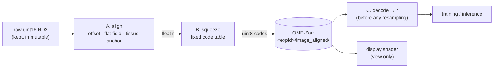
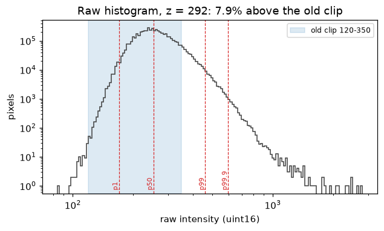
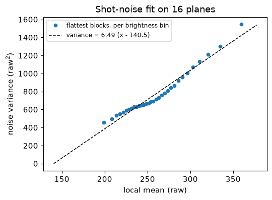
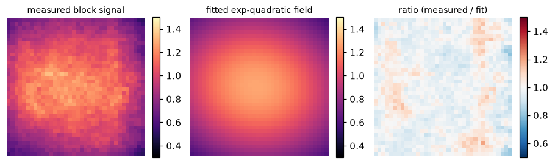
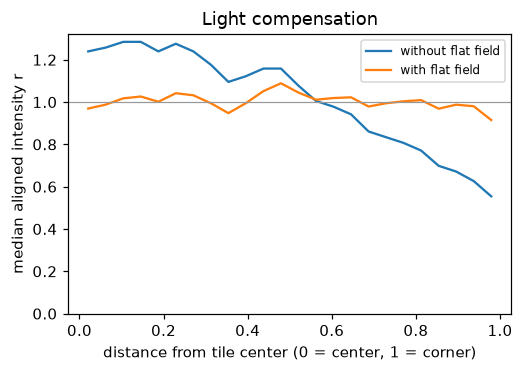
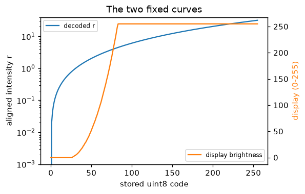
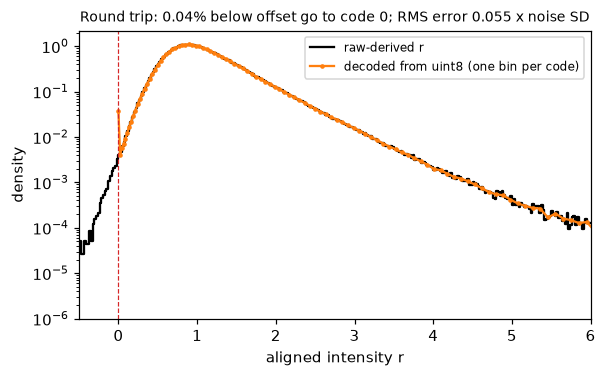
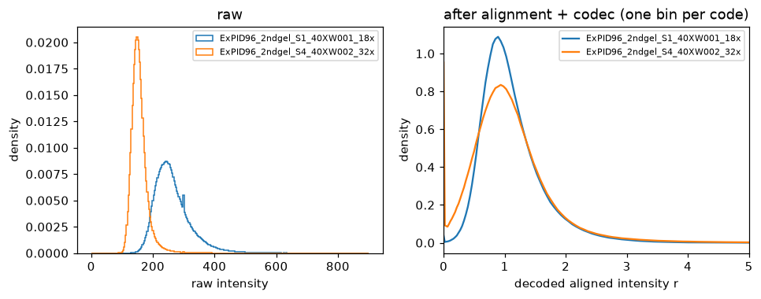
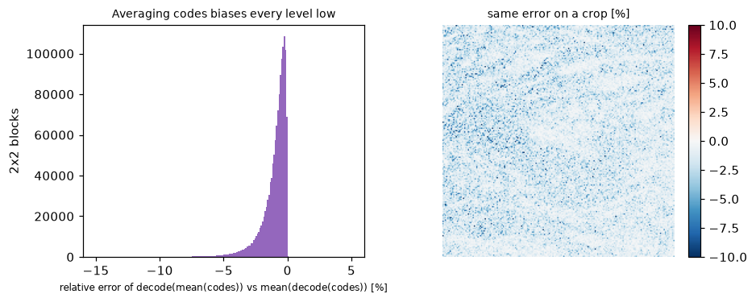
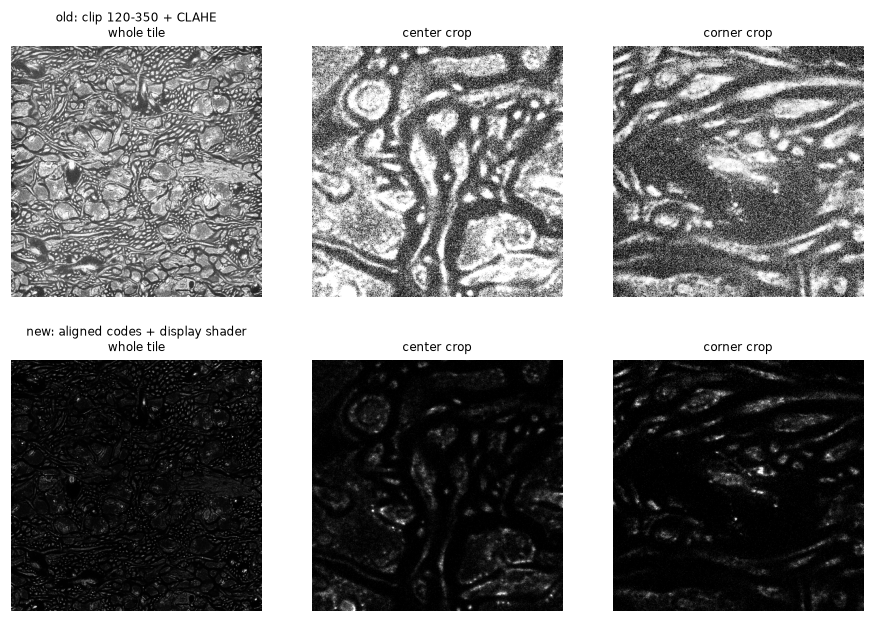

# LICONN preprocessing: raw ND2 → one aligned uint8 copy → model input

How a raw LICONN fluorescence volume becomes the single uint8 copy that serves
both the browser and deep learning, one step at a time, with the code that
runs each step and figures from real data.

The design is the LICONN foundation model preprocessing plan.
This tutorial covers what is implemented in this repository. The items the
plan proposes but that are not built yet are listed at the
[end](#not-implemented-yet).



| Step | What | Code | Output |
|---|---|---|---|
| A | Per volume and channel: noise model, flat field, tissue median | [`alignment.py`](../../connectomics/data/normalization/alignment.py), [`noise.py`](../../connectomics/data/normalization/noise.py) | float aligned intensity `r` |
| B | Fixed code table `r → uint8`, the same for every volume | [`codec.py`](../../connectomics/data/normalization/codec.py) | uint8 HDF5 or OME-Zarr |
| C | Decode `uint8 → r` for the model | `normalize: aligned-u8` in [`augment_ops.py`](../../connectomics/data/augmentation/augment_ops.py), [`build.py`](../../connectomics/data/augmentation/build.py), [`inference/lazy.py`](../../connectomics/inference/lazy.py) | float32 `r` |
| View | Fixed display curve over the same codes | [`display.py`](../../connectomics/data/normalization/display.py) | Neuroglancer shader in `.zattrs` |

All figures come from `ExPID96_2ndgel_S1_40XW001_18x` (Nikon ND2, 585 × 2304 × 2304,
uint16, plane z = 292), and the cross-volume check also uses
`ExPID96_2ndgel_S4_40XW002_32x` (796 × 2304 × 2304). The figure script
reproduces every figure and number:

```bash
python tutorials/liconn_preprocess/make_figures.py \
    --volume "ExPID96_2ndgel_S1_40XW001_18x Mojtaba Tavakoli.nd2" \
    --second "ExPID96_2ndgel_S4_40XW002_32x Mojtaba Tavakoli.nd2"
```

It reads only 16 sampled planes per volume (about 25 s) and writes
`images/*.png` plus [`images/metrics.json`](images/metrics.json).

## Run it

One volume to a uint8 HDF5 file (aligned mode is the default):

```bash
python scripts/preprocess_liconn.py raw_structural.nd2 image_aligned.h5 --channel 0
```

The script prints the fit and a codec QA line, then writes all of it into
the HDF5 attributes. For ExPID96 S1 (the same 16 planes as the figures):

```
Alignment (estimated noise model): offset 140.5, gain 6.491, tissue median 17.1 x gain (100% tissue), flat field min 0.55
Codec QA (sampled planes): below offset 0.04%, above r_max 0.000%, round-trip 0.055 x noise SD
```

To publish OME-Zarr pyramids to GCS, use
[`liconn_ingest`](../liconn_ingest/README.md) (`--clip-mode aligned` is its
default). It calls the same functions and writes the same attributes into
`.zattrs` and `provenance.json`.

## 0. Why the old recipe had to change

The published recipe clipped each plane to fixed raw values 120–350 (or to
per-plane p1–p99), applied CLAHE and stored uint8.



- The fixed clip saturates **7.9%** of pixels at z = 292. The long bright
  tail (p99 = 460, p99.9 = 599, max 2802) is the synapse and vesicle signal.
- Percentile clipping puts every plane and every volume on its own scale, and
  CLAHE changes local contrast by region. Neither is invertible, and the model
  is left to learn each volume's scale from scratch.

## A. Normalization and light compensation

One calibration per acquisition volume and channel, fitted on 16 evenly
spaced Z planes and then frozen. Every plane, training patch and inference
tile uses the same pointwise function:

```
r = (x − offset) / (flat_field(y, x) · tissue_median)
```

`r = 0` is the fitted offset and `r = 1` the median of tissue.

### A1. Offset and gain: shot-noise fit



`noise_curve` measures noise on the flattest 8 × 8 blocks of each brightness
bin (so membranes and puncta do not inflate it), and `estimate_noise_model`
fits `variance = a · mean + b`. For ExPID96: gain `a = 6.49` and offset
`−b / a = 140.5`.

Two caveats are recorded as-is and not hidden:

- The offset is an **empirical intercept**. With read noise it sits below the
  true dark level. Prefer a measured dark frame when one exists.
- The binned points are not a perfect line: the slope is lower near the
  median and higher in the bright tail. This is why `signal / gain` is stored
  as `tissue_median_over_gain`, a relative scale, not a photon count.

### A2. Flat field (light compensation)



The model is exp(quadratic in normalized y, x): six coefficients, fitted to
per-block medians of tissue signal with outlier rejection, and normalized to
median 1. Because it is smooth by construction, cell-scale structure cannot
leak into it. The ratio panel shows no structure left.



Without the flat field, tissue signal falls from about 1.25 at the tile center
to 0.55 at the corners (the fitted field is 0.50× the center at the corner). With it, the profile is flat at about 1. This corrects
brightness only. It does not restore focus at the defocused tile edge, and a
self-estimated field cannot tell broad biology from illumination (see
[not implemented yet](#not-implemented-yet)).

### A3. Tissue anchor

`tissue_median` is the median flat-corrected signal over **tissue blocks**.
A block (the flat-field block size, 64 px here) counts as tissue when its
median signal is at least 3 standard errors of that median above the offset,
and at least one gain unit. The rule is recorded in `.zattrs` as
`tissue_rule`.

> **Changed in this revision.** The prototype used a per-pixel rule,
> `x − offset > 9 · gain` (3σ of a single pixel). S4 is a dim acquisition:
> its tissue median is only about 38 raw units above the offset, below
> 9 · gain ≈ 55. That rule kept only the brightest 23% of S4's pixels, which
> biases the anchor bright, and it left zero blocks for the flat field
> (`fit_alignment` raised). The regional rule keeps all of S4's tissue and
> still excludes empty resin (unit tests
> `test_fit_alignment_keeps_all_tissue_of_a_dim_acquisition` and
> `test_fit_alignment_excludes_empty_regions_from_the_anchor`).

## B. Squeeze to one fixed uint8 table

```
r_clip = clip(r, 0, 32)
code   = round(255 · (√(r_clip + 0.25) − 0.5) / (√32.25 − 0.5))
r_hat  = (0.5 + code/255 · (√32.25 − 0.5))² − 0.25
```



The square root follows shot noise, so each code step is a near-constant
fraction of the local noise. The table is identical for every volume, so a
code means the same aligned intensity everywhere. The codec name
`sqrt_aligned_u8_v1` is stored with the data, and `require_codec` rejects any
other version.

**v1 cannot store negative r.** Everything below the fitted offset becomes
code 0, and the knee does not preserve it. `quantization_report` separates
strict clipping (information v1 cannot store) from endpoint occupancy (code 0
or 255, which also counts in-range values that round there). `fit_alignment`
runs it on the sampled planes and stores the result as `codec_qa_*`
attributes.



| Codec QA, 16 sampled planes | ExPID96 S1 | ExPID96 S4 (dim) |
|---|---|---|
| strictly below offset → code 0 (`clipped_low`) | 0.04% | **0.99%** |
| above r = 32 (`clipped_high`) | 0 | 0.0002% |
| codes used | 198 / 256 | 234 / 256 |
| RMS round-trip error / local noise SD | 0.055 | 0.034 |
| median decoded r (z shown) | 1.03 | 1.03 |

The S4 negative tail (1% of pixels) is the loss the plan asked to measure
before accepting v1. Whether it matters is a task question (faint neurites
near the offset). If it does, it needs a separately versioned signed codec;
v1 must not be silently redefined.

### Cross-volume check on two real acquisitions



The raw volumes differ by 27 counts in fitted offset (140.5 vs 113.5) and
2.9× in tissue signal (111 vs 38 counts above offset). After alignment both are anchored at r ≈ 1, and S4, the lower-SNR
volume, has the wider peak, as expected. A shared scale is a convention, not
proof that two labelings are biologically equivalent.

## C. Decode for deep learning

```yaml
data:
  image_transform:
    normalize: aligned-u8          # decode the fixed table; no per-patch statistics
    clip_percentile_low: 0.0       # required: anything else raises
    clip_percentile_high: 1.0
```

`aligned-u8` returns float32 `r`. Three rules are enforced in code and
covered by tests:

1. **Decode before resampling.** Averaging square-root codes and decoding
   afterwards biases the result low. At z = 292 a single 2 × 2 reduction of
   codes is already −0.7% (median over tissue), and 1.2% of blocks are off
   by more than −5%. The transform builders therefore insert the decode right
   after loading, before `Resized`, padding and cropping. Lazy sliding-window
   inference decodes each crop as it is read, before interpolation.
   Test: `test_aligned_u8_decodes_before_resize_in_train_eager_and_lazy_paths`.

   

2. **No per-patch percentile clipping.** It would put every patch back on its
   own scale, so `smart_normalize`, `SmartNormalizeIntensityd` and
   `LazyVolumeAccessor` raise if `aligned-u8` is combined with clip
   percentiles.
3. **No nnU-Net preprocessing** with `aligned-u8`. It brings its own
   normalization and resampling, so the builder raises.

Keep training-only intensity augmentation (gamma, contrast, noise) on, applied
after decoding, so the model does not overfit one profile.

**Optional uint16 cache.** If IO or another tool needs 16-bit data:

```python
from connectomics.data.normalization import codes_to_u16
u16 = codes_to_u16(codes)   # round(2000 · r_hat); read back with normalize: divide-2000
```

All 256 codes stay distinct (minimum spacing 41 counts, reconstruction error
below 0.00025 in r). This preserves code identity, not the raw volume. Keep
the float path as the default.

## Visualization

The browser applies a display-only shader to the stored codes. It decodes to
`r`, then maps black 0.75 → white 4.5 with γ 1.5. Its `#uicontrol` sliders
change only the view, never the stored data or the model input. The shader is
stored as `neuroglancer_shader` in `.zattrs`, and its width is now guarded
(`max(white − black, 1e-6)`) because the slider ranges overlap.



The old view (top) is dominated by CLAHE-amplified noise, and its corner looks
as crisp as the center. The aligned view (bottom) has matching brightness at
center and corner, and the puncta stand out. With these defaults most tissue
sits near black, so the whole tile looks dark. Treat the defaults as a choice
for inspecting puncta and use the sliders for membranes. They were chosen on
one volume.

## Not implemented yet

These are in the plan but not in this revision:

- A strict preprocessing specification with a stable hash, stored in the
  manifest, cache keys, checkpoints and predictions, plus an artifact manifest
  and valid-mask contract.
- Full-FOV voxel-overlap resampling with fractional edge weights, and NGFF
  translations. The current pyramid drops odd trailing voxels and records
  `spacing · 2^level` with no translation.
- An independent or shared flat field, and a bounded correction strength.
- Using measured dark and flat frames instead of the empirical offset.
- A signed codec, if the negative-tail loss above matters for a task.
- The multi-volume ablations and task gates (merge/split, ERL, puncta
  precision and recall) before a released codec.
- `ingest.py check` still audits only object completeness. It does not
  validate the codec or geometry.
